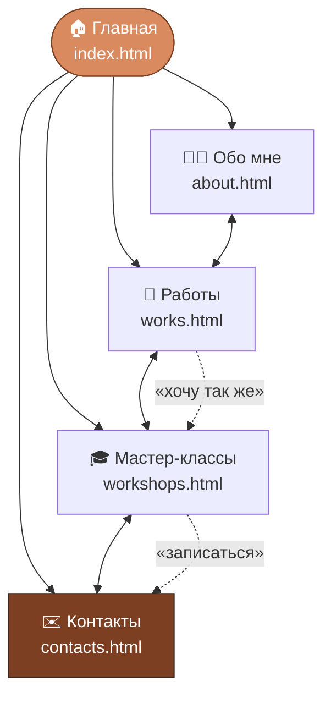
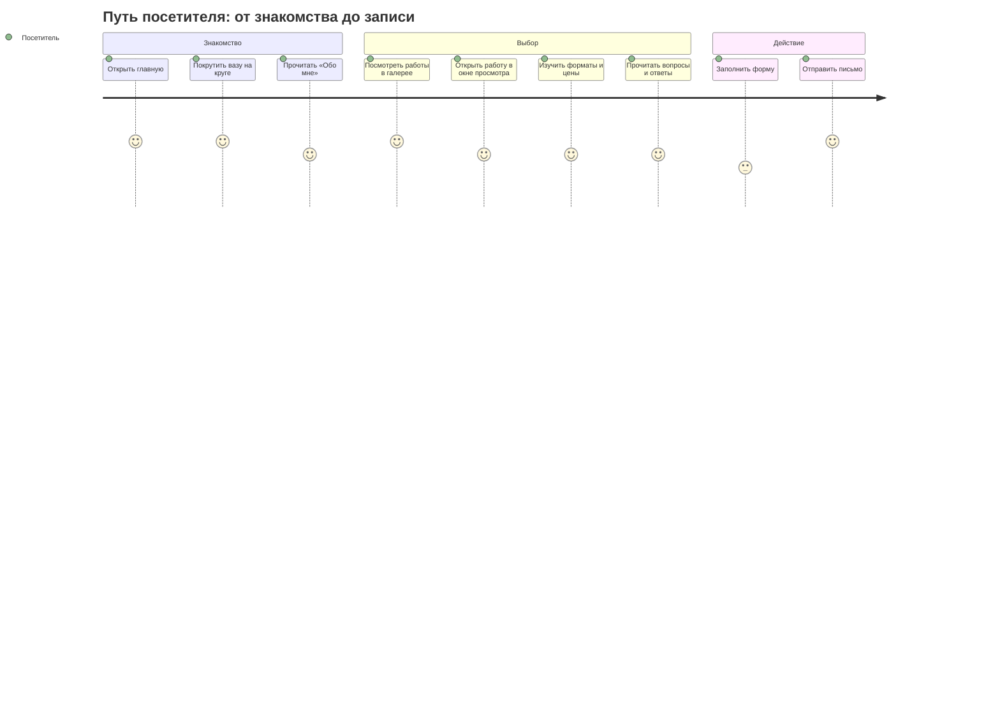
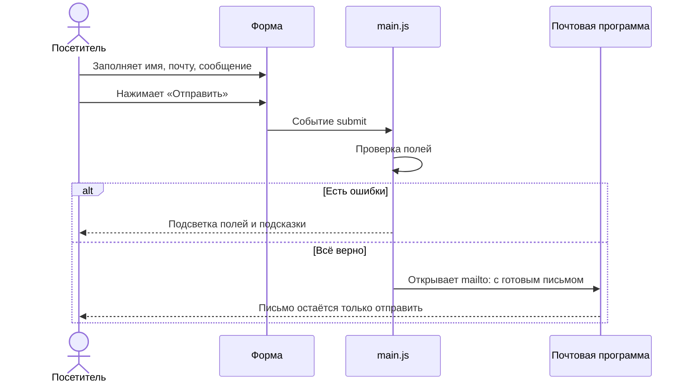
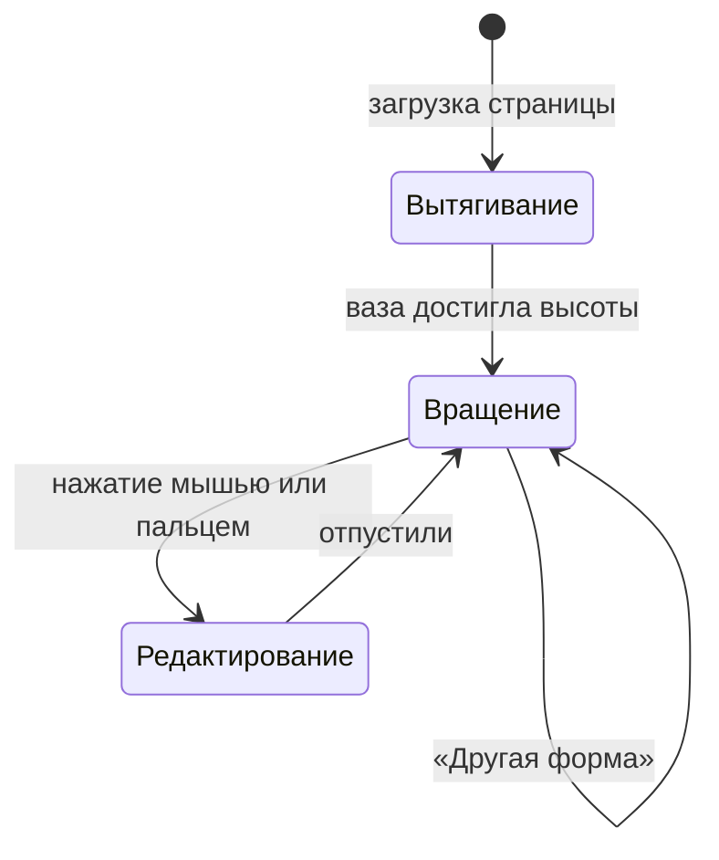
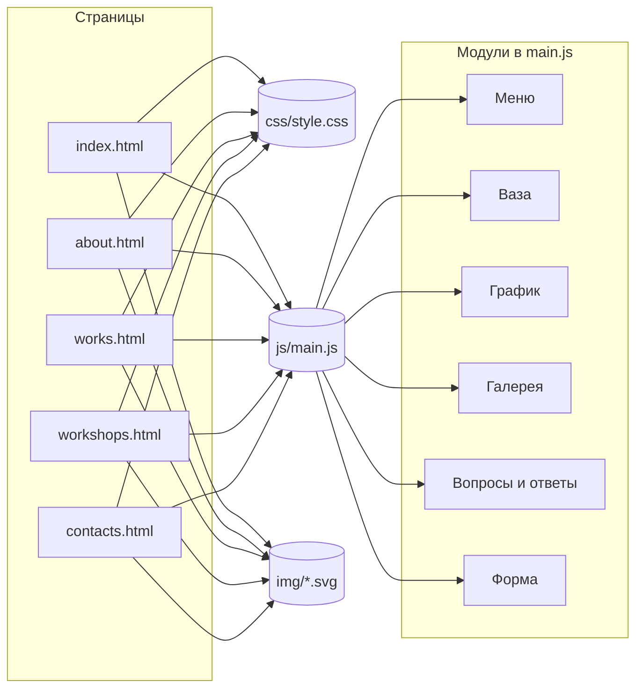
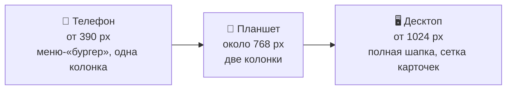

<div align="center">


# Марта Левина — керамика

**Сайт-визитка мастера-керамиста: вазы, чаши и тарелки ручной работы, а также мастер-классы по гончарному кругу и ручной лепке.**


</div>

---

## Содержание

1. [О проекте](#о-проекте)
2. [Быстрый старт](#быстрый-старт)
3. [Карта сайта](#карта-сайта)
4. [Как посетитель проходит по сайту](#как-посетитель-проходит-по-сайту)
5. [Функциональность](#функциональность)
6. [JS-эффекты по страницам](#js-эффекты-по-страницам)
7. [Архитектура и структура файлов](#архитектура-и-структура-файлов)
8. [Адаптивность](#адаптивность)
9. [Доступность](#доступность)
10. [Технологии и принципы](#технологии-и-принципы)
11. [Возможные улучшения](#возможные-улучшения)
12. [Разработчики](#разработчики)

---

## О проекте

Керамика — занятие неспешное, и сайт о ней не должен торопить. Мы хотели сделать спокойную, тёплую и понятную визитку, в которой посетитель за пару минут:

- **знакомится с мастером** — кто она, как работает и чем отличается её подход;
- **видит работы** — вазы, чаши и тарелки, которые можно рассмотреть вблизи;
- **узнаёт о занятиях** — форматы, цены и ответы на частые вопросы;
- **связывается или записывается** — без регистраций и лишних шагов.

Сайт написан на **чистых HTML, CSS и JavaScript**: без фреймворков, сборщиков и зависимостей. Все изображения нарисованы в **SVG**, поэтому они чёткие на любом экране, весят считанные килобайты и подстраиваются под цветовую схему сайта.

> **Почему без фреймворков?** Сайт небольшой, пять страниц и одна общая логика. Лишние инструменты только усложнили бы поддержку: открыл файл в браузере, и всё работает.

---

## Быстрый старт

Сборка не нужна. Есть три способа открыть сайт.

**Способ 1. Просто открыть файл.**
Дважды щёлкните по `index.html`, и сайт откроется в браузере.

**Способ 2. Локальный сервер** (удобнее при разработке):

```bash
# Python 3
python -m http.server 8000

# или Node.js
npx serve .
```

После этого откройте <http://localhost:8000>.

**Способ 3. Выложить на хостинг.**
Подойдёт любой статический хостинг: GitHub Pages, Netlify, Cloudflare Pages или обычный shared-хостинг. Достаточно загрузить содержимое папки как есть.

---

## Карта сайта

На сайте пять страниц с общей шапкой. Из любой страницы можно попасть в любую другую.



| Страница | Файл | Что на ней |
|---|---|---|
| Главная | `index.html` | Ваза на круге, недавние работы, ближайшие занятия |
| Обо мне | `about.html` | Этапы работы, график обжига, хронология |
| Работы | `works.html` | Галерея с фильтром и окном просмотра |
| Мастер-классы | `workshops.html` | Форматы, цены, вопросы и ответы |
| Контакты | `contacts.html` | Реквизиты и форма связи |

---

## Как посетитель проходит по сайту

Типичный путь человека, который хочет попасть на мастер-класс:



А так работает **форма на странице «Контакты»**:



---

## Функциональность

### Основное

- **Адаптивный дизайн.** Сайт корректно выглядит на экранах от телефонов (390 px) до десктопа. На узких экранах навигация сворачивается в меню.
- **Навигация между страницами.** Общая шапка на пяти страницах, текущая страница подсвечивается. Для клавиатуры есть ссылка «К содержимому».
- **Иллюстрации в SVG.** Изделия, мастерская и favicon нарисованы векторно.

### Доступность

- видимый фокус при навигации с клавиатуры;
- подписи для скринридеров;
- отключение анимаций для тех, кто выбрал в системе «уменьшить движение».

---

## JS-эффекты по страницам

Вся логика лежит в одном файле `js/main.js` и подключается на каждой странице. Каждый блок включается только там, где нужные элементы есть.

| Страница | Эффект | Как это работает |
|---|---|---|
| **Все** | Мобильное меню | Кнопка-«бургер» раскрывает и сворачивает навигацию |
| **Главная** | Ваза на круге | При загрузке ваза «вытягивается», потом вращается; форму можно менять мышью или пальцем, а кнопка «Другая форма» подбирает новую |
| **Обо мне** | График обжигов | Две кривые температуры прорисовываются, когда пользователь доскролливает до графика |
| **Работы** | Фильтр | Карточки фильтруются по типу изделий и плавно переставляются |
| **Работы** | Окно просмотра | Клик по работе открывает увеличенное изображение с описанием |
| **Мастер-классы** | Вопросы и ответы | Раскрывающиеся блоки, одновременно можно держать открытыми несколько |
| **Контакты** | Форма | Проверка полей и открытие готового письма в почтовой программе |

### Ваза на гончарном круге

Форма вазы описывается набором радиусов по высоте. При перетаскивании меняются радиусы выбранного уровня, и силуэт перерисовывается.



### График двух обжигов

Керамика обжигается дважды, и это видно на графике со страницы «Обо мне»:

- **утельный обжиг** (≈ 950 °C) — глина превращается в прочный, но пористый черепок;
- **глазурный обжиг** (≈ 1250 °C) — глазурь расплавляется и превращается в стекловидное покрытие.


Линии прорисовываются приёмом `stroke-dasharray` / `stroke-dashoffset`, а запуск анимации отслеживает `IntersectionObserver`: пока график не попал в окно, он остаётся невидимым.

### Путь изделия от глины до полки

Этапы работы, о которых рассказывает страница «Обо мне», выстраиваются в такую цепочку:

```mermaid
flowchart LR
    A[🪨 Глина<br/>подготовка и замес] --> B[🌀 Формовка<br/>круг или ручная лепка]
    B --> C[💨 Сушка<br/>несколько дней]
    C --> D[🔥 Утельный обжиг<br/>≈ 950 °C]
    D --> E[🎨 Глазурование<br/>и роспись]
    E --> F[🔥 Глазурный обжиг<br/>≈ 1250 °C]
    F --> G[🏺 Готовая работа<br/>в галерее на сайте]

    C -. трещина или деформация .-> B
    F -. брак .-> E

    style A fill:#e9d6bf,stroke:#7d3f22
    style D fill:#d98a5f,stroke:#7d3f22,color:#fff
    style F fill:#7d3f22,stroke:#3b2a1e,color:#fff
    style G fill:#a4532f,stroke:#3b2a1e,color:#fff
```



---

## Архитектура и структура файлов

```text
.
├── index.html        # Главная: ваза на круге, недавние работы, ближайшие занятия
├── about.html        # Обо мне: этапы работы, график обжига, хронология
├── works.html        # Работы: галерея с фильтром и окном просмотра
├── workshops.html    # Мастер-классы: форматы, цены, вопросы и ответы
├── contacts.html     # Контакты: реквизиты и форма
├── css/
│   └── style.css     # Все стили: цвета, шрифты, сетка, адаптивность
├── js/
│   └── main.js       # Вся логика: меню, ваза, график, галерея, форма
├── img/              # SVG-иллюстрации изделий и мастерской, favicon
├── docs/             # Картинки для этого README
│   ├── banner.svg
│   └── firing-chart.svg
└── README.md
```

Как части проекта связаны между собой:



---

## Адаптивность

Дизайн строится «от малого к большому»: сначала макет для телефона, потом расширения для планшетов и десктопов.



| Диапазон | Навигация | Сетка карточек |
|---|---|---|
| от 390 px | Свёрнута в меню | 1 колонка |
| около 768 px | Свёрнута в меню или полная | 2 колонки |
| от 1024 px | Полная шапка | 3 колонки и больше |

---

## Доступность

Сайт должен быть удобен всем, в том числе тем, кто не пользуется мышью.

- [x] Ссылка **«К содержимому»** позволяет пропустить шапку с клавиатуры
- [x] **Видимый фокус** на всех интерактивных элементах
- [x] **Подписи для скринридеров** у кнопок, иконок и полей формы
- [x] Уважение настройки **`prefers-reduced-motion`**: анимации отключаются
- [x] Текущая страница в навигации помечается и визуально, и программно
- [x] Ошибки формы описываются текстом, а не только цветом

---

## Технологии и принципы

| Технология | Зачем |
|---|---|
| **HTML5** | Семантическая разметка: `header`, `nav`, `main`, `section`, `footer` |
| **CSS3** | Переменные для цветов и шрифтов, Grid и Flexbox, медиазапросы |
| **JavaScript (ES6+)** | Интерактивность без библиотек |
| **SVG** | Все изображения: чёткие и лёгкие |

Принципы, которых мы придерживались:

1. **Простота.** Никаких сборщиков и зависимостей.
2. **Один источник правды.** Цвета и шрифты заданы в одном месте, в `style.css`.
3. **Прогрессивное улучшение.** Контент доступен и без JavaScript, а скрипт добавляет удобство.
4. **Доступность по умолчанию.** Это часть разработки, а не опция.

---

## Возможные улучшения

- [ ] Тёмная тема
- [ ] Запись на мастер-класс прямо на сайте, с выбором даты
- [ ] Подключение отправки формы через сервис форм
- [ ] Английская версия сайта
- [ ] Карточки работ с несколькими ракурсами

---

## Разработчики

- Спанч Боб
- Лоботомия и Лобзик Зубаревы
- Гейб
- Чипсы Лейс со вкусом опилок
- Гуру по создаванию проблем из воздуха
- ~~Пынзарь Владислав (он просто смотрел)~~ — уже уволен

<div align="center">

*Сделано с глиной, вниманием и чашкой чая* 🍵

</div>
